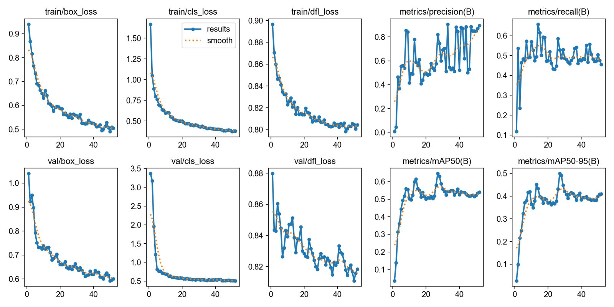
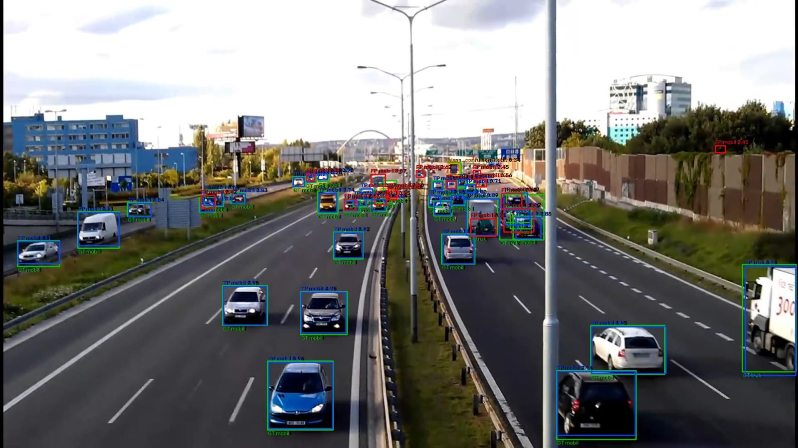

# Vehicle detection in three traffic videos

Diaz Amantajati Susilo · 26 November 2026 · Code: <https://github.com/amantajatii/video-to-yolo-vehicle-detection>

The submitted YOLO11n detector reached **0.857 mAP50 and 0.636 mAP50–95** on 54 held-out frames. Fine-tuning helped most with trucks. On the same COCO-style evaluation, truck AP50 rose from 0.396 with the original weights to 0.767 after training. Distant vehicles in dense traffic remained difficult.

The submission pairs the first reviewed dataset (v1) with the seed 42 checkpoint from epoch 27. Two further review passes corrected 126 boxes in the training and validation sets, producing v2. On the test set, v2 scored lower than v1 with seed 42 and higher with seed 1.

## 1. From video to dataset

All 380 images came from the three supplied videos. The first shows a highway from a fixed camera. The second follows highway traffic from several handheld positions. The third shows a busier urban road and provides many of the trucks and buses.

I sampled each video at four frames per second, then removed the blurriest 10% of candidates and frames with extreme brightness. Frames likely to contain buses or trucks took priority, and the remaining places were spread across each video’s timeline. This left 397 frames.

Neighbouring frames often show the same vehicles, so a random split would leak near-duplicates into the test set. I divided each video into ten time blocks and assigned whole blocks to training, validation or test. A 1.5-second buffer around split boundaries removed 17 frames. The split was fixed before any annotation review. All three videos appear in every split, so the test measures performance at other times in familiar scenes. Performance on a new camera is still an open question.

| Split | Images | mobil | truk | bus |
|---|---:|---:|---:|---:|
| Train | 275 | 4,558 | 213 | 52 |
| Validation | 51 | 899 | 61 | 9 |
| Test | 54 | 882 | 54 | 10 |
| **Total** | **380** | **6,339** | **328** | **71** |

The three videos contribute unevenly, and Video 1 contains no buses.

| Video | Train img | Val img | Test img | mobil | truk | bus |
|---|---:|---:|---:|---:|---:|---:|
| Video 1 | 64 | 7 | 15 | 1,586 | 37 | 0 |
| Video 2 | 69 | 34 | 21 | 2,268 | 177 | 28 |
| Video 3 | 142 | 10 | 18 | 2,485 | 114 | 43 |

Of the 6,738 annotated boxes, 94% are cars, giving a mobil : truk : bus ratio of about 89 : 4.6 : 1. Each image holds 17.7 boxes on average. Using COCO area buckets in original pixels, 44% of boxes are small (below 32 × 32), 42% medium and 14% large (96 × 96 or above). The median shortest box side is 32 pixels. The median box measures 38 × 31 pixels for mobil, 72 × 75 for truk and 121 × 154 for bus, so most cars are much smaller than the other two classes. Both scale and class balance matter when interpreting the overall score. All statistics are produced by `scripts/dataset_stats.py`.

## 2. Annotation decisions

YOLO11x supplied initial boxes on each full frame and on overlapping tiles. During inspection, some distant cars that appeared to be missing had in fact been detected and then removed by a 12-pixel size filter. Lowering the cutoff to 8 pixels recovered them. For class corrections, CLIP identified pickups and vans that the teacher had labelled as trucks, and I applied 205 corrections from truk to mobil. CLIP’s bus predictions were less reliable, so I reviewed every disagreement involving buses by hand.

The class definitions follow visible body shape. Pickups and panel vans count as mobil. A goods vehicle with a cargo body separate from the cab counts as truk. A bus-bodied passenger vehicle counts as bus. For partially hidden vehicles, the box covers the visible portion when enough of the vehicle is visible to recognise it. Motorcycles, pedestrians and towed trailers are outside the three classes.

I reviewed every selected frame in X-AnyLabeling. A second pass over all 54 test frames changed 27 of the 941 boxes present at the start of that pass, and the final test set contains 946 boxes. I performed both passes myself, so the 2.9% revision rate measures how much changed on reinspection. An independent annotation audit would be needed to estimate the remaining error.

## 3. Training and checkpoint selection

I fine-tuned a COCO-pretrained YOLO11n on an Apple M1 using Python 3.10.22 and Ultralytics 8.4.123. The small model fit the available hardware. A 960-pixel input preserves detail in distant vehicles; the other settings were batch size 8 and AdamW with an initial learning rate of 0.001. Training allowed up to 100 epochs with early-stopping patience of 25. The submitted run took 53.5 minutes and ended at epoch 52. Its best validation checkpoint came from epoch 27.

## 4. Test results

| Class | Test boxes | Precision | Recall | mAP50 | mAP50–95 |
|---|---:|---:|---:|---:|---:|
| All | 946 | 0.793 | 0.766 | 0.857 | 0.636 |
| mobil | 882 | 0.889 | 0.869 | 0.929 | 0.713 |
| truk | 54 | 0.874 | 0.630 | 0.798 | 0.587 |
| bus | 10 | 0.618 | 0.800 | 0.844 | 0.609 |

The table above uses the Ultralytics evaluator. For the comparison below, I scored both models with the same COCO evaluator and mapped car, truck and bus to the project classes.

| YOLO11n | COCO AP | AP50 | AP small | AP medium | AP large |
|---|---:|---:|---:|---:|---:|
| COCO weights | 0.471 | 0.622 | 0.180 | 0.460 | 0.642 |
| Fine-tuned (v1) | 0.612 | 0.842 | 0.306 | 0.641 | 0.769 |

At a confidence threshold of 0.25 and IoU of 0.5, the detector found 32 of 54 trucks with the correct class (recall 0.593) and predicted ten trucks as cars. Seven of its 15 bus predictions were correct (precision 0.467). With only ten labelled buses, one additional correct detection would change bus recall by ten percentage points.

Small vehicles accounted for 179 of 232 unmatched predictions and 52 of 74 unmatched ground-truth boxes. Another 21 detections matched a vehicle but assigned the wrong class. Counting each of those as both a false positive for the predicted class and a false negative for the true class gives 253 false positives and 95 false negatives.

On the M1 (MPS) at 960 pixels, inference took 7.02 ms per image after warm-up. This timing covers inference alone and excludes image preparation and postprocessing.

## 5. Did the extra label review help?

I used the first detector to flag possible missing boxes, misplaced boxes and class disagreements on training and validation frames, then checked each candidate by hand. For example, some car-carrier boxes covered only the cab and needed to include the full vehicle. Across the two additional review passes, 60 boxes were added, 25 removed, 25 reclassified and 16 resized. These revised annotations form v2. Both versions use the same frames and test labels.

I compared checkpoints on the same revised validation labels and used validation mAP50–95 for selection. The plan called for three seeds per version. The longest completed run took 88.6 minutes and ended at epoch 87. At the reporting cutoff, v1 seed 2 was incomplete and v2 seed 2 had not started. The table includes the four completed runs.

| Labels | Seed | Best epoch | Val mAP50–95 | Test mAP50 | Test mAP50–95 |
|---|---:|---:|---:|---:|---:|
| v1 | 42 | 27 | 0.491 | 0.857 | 0.636 |
| v1 | 1 | 24 | 0.467 | 0.800 | 0.635 |
| v2 | 42 | 17 | 0.443 | 0.782 | 0.581 |
| v2 | 1 | 62 | 0.465 | 0.821 | 0.653 |

I selected v1, seed 42, because it had the highest validation mAP50–95 (0.491) among the four runs. Version v1 also scored higher than v2 on validation for both seeds, although by only 0.002 for seed 1. On the test set, the two seed pairs showed mixed results for v2, so the effect of the additional label review remains uncertain.

## 6. Limits and next steps

**Model limitations.** The detector is weakest on small, distant vehicles. COCO AP for small objects is 0.306, against 0.769 for large ones, and small vehicles make up most of the missed and spurious detections. At a confidence threshold of 0.25, the detector labelled 10 of the 54 test trucks as cars. Bus results rest on ten test instances, and only seven of 15 bus predictions were correct (precision 0.467), so the bus score could move by a large margin on a different sample. Results also vary between training runs: test mAP50 for the two v1 seeds ranged from 0.800 to 0.857. The model has only seen these three daytime cameras, so its behaviour at night, in rain or from a new viewpoint is unknown. The 7.02 ms timing was measured on one machine and does not include the full pipeline.

YOLO11x, used without fine-tuning, scored 0.521 AP on small objects, compared with 0.306 for the fine-tuned YOLO11n. The two models differ in size and training history, and the annotations started from YOLO11x predictions, which may favour it. A controlled comparison would help determine whether a larger model improves small-object detection.

**Data limitations.** The dataset covers three daytime videos, with few buses and many small vehicles. The labels also share a common starting point in the teacher’s predictions, so objects the teacher missed could have escaped manual review.

**Next steps.** For a follow-up on the same footage, I would ask a second reviewer to annotate a sample of dense frames from scratch and compare missed vehicles and van/truck decisions. A controlled run with a larger model (YOLO11s or YOLO11m) or a higher input resolution, trained on the same data, would test whether the small-vehicle gap narrows. To assess transfer to a new scene, I would hold out a full video and report how many examples of each class it contains.
